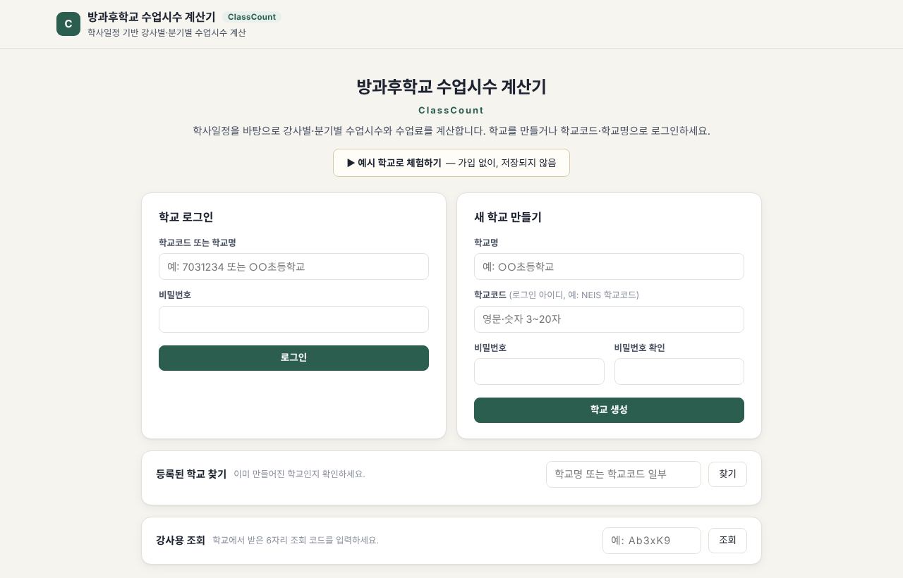
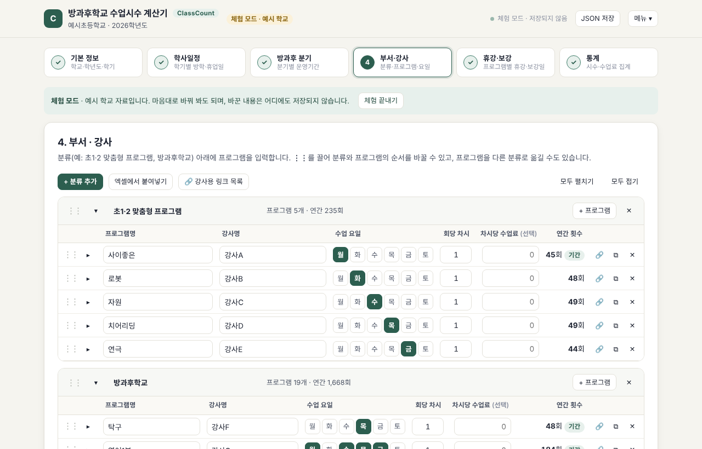
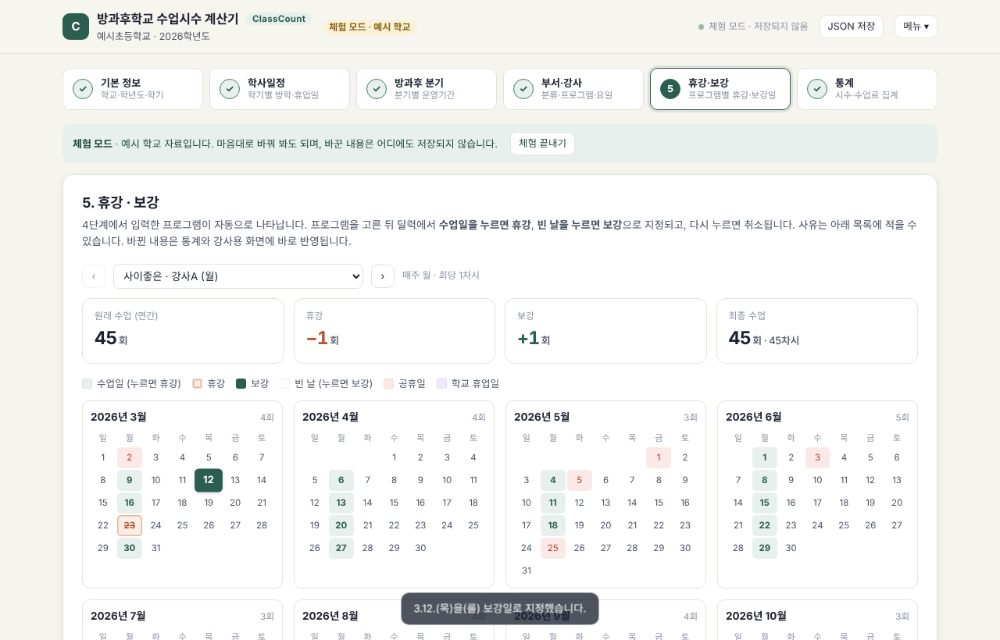
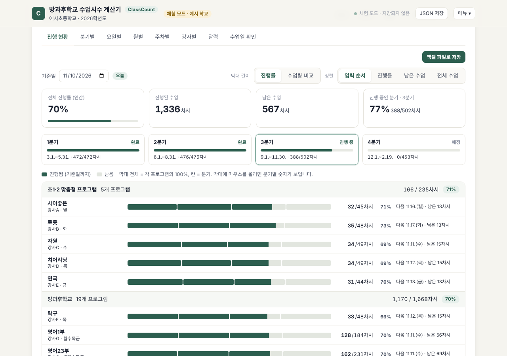

# ClassCount · 방과후학교 수업시수 계산기

**ClassCount**(클래스카운트)는 학사일정을 바탕으로 **방과후학교 강사별·분기별 수업시수와 수업료**를 계산하는 웹앱입니다.
학년도·방학·휴업일·분기·프로그램(요일)을 입력하면 분기별·요일별·월별·주차별·강사별 시수가 자동으로 계산되고, 엑셀로 내려받을 수 있습니다.
엑셀 수업일지에 날짜마다 부서명을 적어 세던 방식을 대신하려고 만들었습니다.

- **바로 써 보기**: <https://yourjune21.github.io/classcount/> (GitHub Pages, 기기 전용 버전 — 저장소에서 Pages를 켠 뒤 열림) → ‘예시 학교로 체험하기’
- **내 학교용으로 가져가기**: [Use this template](https://github.com/yourjune21/classcount/generate) 또는 [Fork](https://github.com/yourjune21/classcount/fork)
- **현재 버전**: v1.11.1 — [변경 내역](CHANGELOG.md)
- **라이선스**: [MIT](LICENSE) — 학교·교육청에서 자유롭게 복사·수정·배포할 수 있습니다

---

## 주요 기능

| 구분 | 내용 |
|---|---|
| 6단계 입력 | ① 기본 정보 → ② 학사일정 → ③ 방과후 분기 → ④ 부서·강사 → ⑤ 휴강·보강 → ⑥ 통계 |
| 학사일정 | 학년도 입력 시 기간 자동(3.1.~다음 해 2월 말), 공휴일 자동 추가(2026~2028), 1학기 종료일·2학기 시작일로 여름방학 자동, 방학 중 운영 여부, 공휴일(빨강)·학교 휴업일(보라) 구분 |
| 분기 | 기본 4분기 자동 생성, 분기 종료일 → 다음 분기 시작일(다음 평일) 자동, 5주차 수업 켜기/끄기 |
| 부서·강사 | 분류 > 프로그램 2단계, 끌어서 순서 변경, 요일·회당 차시·차시당 수업료, 프로그램별 운영기간·방학/5주차 설정 |
| 휴강·보강 | 달력에서 수업일 클릭 = 휴강, 빈 날 클릭 = 보강, 사유 기록 |
| 통계 | **진행 현황(기준일까지 프로그램별 진행을 가로 막대그래프로)**·분기별·요일별·월별·주차별·강사별·달력·수업일 확인, 제목 클릭 정렬, 분류별 소계, 1학기/2학기/연간, 엑셀 내보내기 |
| 학교 계정 | 학교명·학교코드·비밀번호로 생성, 학교코드 또는 학교명으로 로그인, 등록 학교 찾기 |
| 강사용 링크 | 프로그램마다 6자리 링크 — 강사는 로그인 없이 자기 수업일·시수·학사일정만 조회(수업료는 비공개) |
| 학년도 전환 | 프로그램은 그대로 복사하고 학사일정은 새로 준비, 지난 학년도는 조회 전용 보관 |
| 최고관리자 | 전체 학교 목록·입력사항 보기·비밀번호 초기화·학교 삭제·**새 학교 생성 켜기/끄기** |

| 프로그램 입력 | 휴강·보강 | 진행 현황 |
|---|---|---|
|  |  |  |

---

## 어떻게 쓰나요? (배포 방법 3가지)

| 방법 | 학교 계정·최고관리자·강사용 링크 | 비용 | 난이도 | 안내 |
|---|---|---|---|---|
| **A. Cloudflare Pages + GitHub 연동** (권장) | ✅ 모두 사용 | 무료(하루 저장 1,000회까지) | 보통 | [docs/DEPLOY_CLOUDFLARE.md](docs/DEPLOY_CLOUDFLARE.md) |
| **B. GitHub Pages** | ❌ ‘이 기기에서만 사용’·체험만 | 무료 | 쉬움 | 아래 B |
| **C. 파일 하나로 쓰기** | ❌ ‘이 기기에서만 사용’·체험만 | 무료 | 가장 쉬움 | 아래 C |

### A. Cloudflare Pages (여러 학교가 함께 쓸 때)
1. 이 저장소를 [Fork](https://github.com/yourjune21/classcount/fork)하거나 [Use this template](https://github.com/yourjune21/classcount/generate)으로 내 GitHub 계정에 가져옵니다.
2. Cloudflare에서 **KV 저장소**를 만들고, **Pages 프로젝트**를 GitHub 저장소와 연결합니다.
   - 빌드 명령: `npm run build` · 출력 폴더: `public`
3. 프로젝트 설정에 KV 연결(`SCHOOLS`)과 비밀값(`ADMIN_PASSWORD`, `TOKEN_SECRET`)을 넣고 다시 배포합니다.
4. 프로젝트 이름을 `classcount` 로 하면 주소는 `https://classcount.pages.dev` 가 됩니다(이미 쓰이는 이름이면 다른 이름으로).

화면 위치까지 자세한 순서는 **[docs/DEPLOY_CLOUDFLARE.md](docs/DEPLOY_CLOUDFLARE.md)** 에 있습니다. 이후에는 GitHub에 수정 사항을 올릴 때마다 자동으로 다시 배포됩니다.

### B. GitHub Pages (나 혼자, 또는 한 학교에서 기기별로 쓸 때)
1. 이 저장소를 Fork합니다.
2. 저장소 **Settings → Pages → Source**를 **GitHub Actions**로 바꿉니다.
3. **Actions** 탭에서 ‘GitHub Pages (기기 전용 버전)’이 끝나면 `https://<아이디>.github.io/classcount/` 로 접속합니다. (이 저장소: <https://yourjune21.github.io/classcount/>)

입력 내용은 그 기기 브라우저(쿠키·저장소)에만 저장되므로, **JSON 파일로 저장**해 보관·이동하세요.

### C. 파일 하나로 쓰기
[`public/index.html`](https://github.com/yourjune21/classcount/raw/main/public/index.html) 을 내려받아 브라우저로 열면 됩니다(인터넷 연결 필요: 글꼴·엑셀 내보내기용). B와 같은 ‘이 기기에서만 사용’ 방식입니다.

---

## 설명서

| 문서 | 대상 |
|---|---|
| [사용 설명서](docs/USER_GUIDE.md) | 방과후 담당 교사 — 단계별 입력, 휴강·보강, 강사용 링크, 학년도 전환 |
| [관리자 안내](docs/ADMIN_GUIDE.md) | 최고관리자 — 학교 관리, 비밀번호 초기화, 새 학교 생성 켜기/끄기 |
| [Cloudflare 배포](docs/DEPLOY_CLOUDFLARE.md) | 운영 담당 — GitHub 연동, KV·비밀값 설정, 업데이트 |
| [GitHub에 올리기](docs/GITHUB_UPLOAD.md) | 처음 GitHub을 쓰는 분 — zip 파일을 저장소로 올리는 방법 |
| [개발 안내](docs/DEVELOPMENT.md) | 고쳐 쓰려는 분 — 폴더 구조, 빌드, 테스트, 버전 관리, 서버 API |

---

## 계산 규칙 (요약)

- **수업일** = 분기 기간 안 + 휴업일 아님 + (방학이면 방학 운영 설정) + 프로그램 운영기간 안 + 휴강일 아님 + 요일 일치 + (5주차 미운영이면 5주차 아님). 보강일은 요일과 관계없이 더함
- **시수** = 수업 횟수 × 회당 차시, **수업료** = 시수 × 차시당 수업료
- 기존 엑셀 수업일지(2026학년도 24개 부서)와 대조해 분기별 횟수가 일치하는지 자동 테스트(`npm test`)로 확인합니다

## 개인정보·보안 안내

- 학생 이름 등 **개인정보는 입력하지 마세요.** 이 앱은 프로그램·강사·일정 정보만 다루도록 만들었습니다.
- Cloudflare 배포 시 학교 비밀번호는 서버에서 PBKDF2로 암호화해 저장하며, 10회 실패 시 10분간 로그인이 잠깁니다.
- 강사용 링크로는 수업료·메모가 전달되지 않습니다. 링크가 퍼졌다면 ‘새 링크 만들기’로 바꾸세요.

## 문의·기여

오류나 개선 의견은 [GitHub Issues](https://github.com/yourjune21/classcount/issues)에 남겨 주세요. 코드를 고쳐 보내 주실 때는 [개발 안내](docs/DEVELOPMENT.md)의 순서(빌드 → 테스트 → 버전 올리기)를 따라 주세요.
