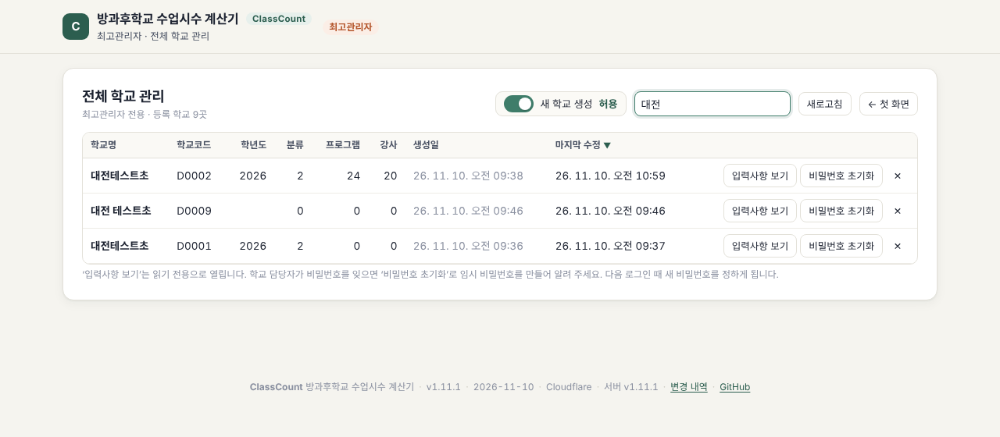

# ClassCount 관리자 안내 (최고관리자용)

## 들어가기
| 배포 방식 | 최고관리자 |
|---|---|
| Cloudflare Pages | 첫 화면 아래 **‘최고관리자 로그인’** → Cloudflare에 설정한 `ADMIN_PASSWORD` |
| claude.ai 웹앱 | 웹앱 소유자 계정으로 열면 자동 인식(첫 화면에 ‘전체 학교 관리’) |

최고관리자 로그인은 12시간 유지되며, ‘관리자 로그아웃’으로 끝낼 수 있습니다.

## 할 수 있는 일
| 기능 | 설명 |
|---|---|
| 학교 목록 | 학교명·학교코드·학년도·분류·프로그램·강사 수·생성일·마지막 수정. 제목 클릭 정렬, 검색 |
| **새 학교 생성 켜기/끄기** | 목록 위 스위치. 끄면 첫 화면의 ‘새 학교 만들기’가 막히고, 서버도 생성 요청을 거절합니다(이미 등록된 학교의 로그인은 그대로) |
| 입력사항 보기 | 학교의 6단계 내용과 통계를 **읽기 전용**으로 엽니다. 상단 학년도 선택으로 지난 학년도도 볼 수 있습니다 |
| 비밀번호 초기화 | 6자리 임시 비밀번호를 만들어 알려 줍니다. 학교 담당자는 다음 로그인 때 새 비밀번호를 정합니다. 기존 로그인은 모두 끊깁니다 |
| 학교 삭제 | 학교코드를 다시 입력해야 삭제됩니다. 지난 학년도·강사용 링크까지 함께 지워지며 되돌릴 수 없습니다 |

## 운영 팁
- 참여 학교 모집 기간에만 ‘새 학교 생성’을 켜 두고, 이후에는 꺼 두면 낯선 학교가 등록되는 것을 막을 수 있습니다.
- 학교코드는 NEIS 학교코드처럼 겹치지 않는 값을 쓰도록 안내하세요. 같은 학교명이 여럿이면 학교명 로그인이 막히고 코드로만 들어갈 수 있습니다.
- `ADMIN_PASSWORD` 를 바꾸려면 Cloudflare 설정에서 값을 바꾸고 다시 배포합니다.
- 정기적으로 각 학교에 **JSON 저장** 백업을 권하세요.

## claude.ai 웹앱으로 운영할 때의 차이
- 학교 자료를 저장할 수 있는 사람은 웹앱 소유자와 이메일로 ‘편집자’ 초대를 받은 claude.ai 사용자뿐입니다.
- 학교 비밀번호·새 학교 생성 설정은 화면에서 지키는 수준의 보호입니다(Cloudflare 배포는 서버가 직접 막습니다).
