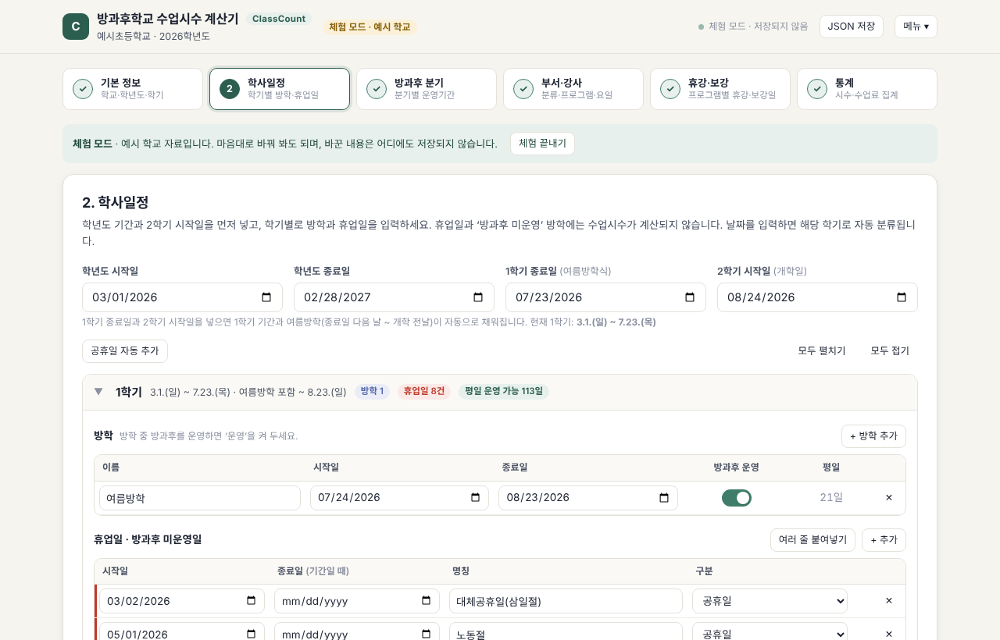
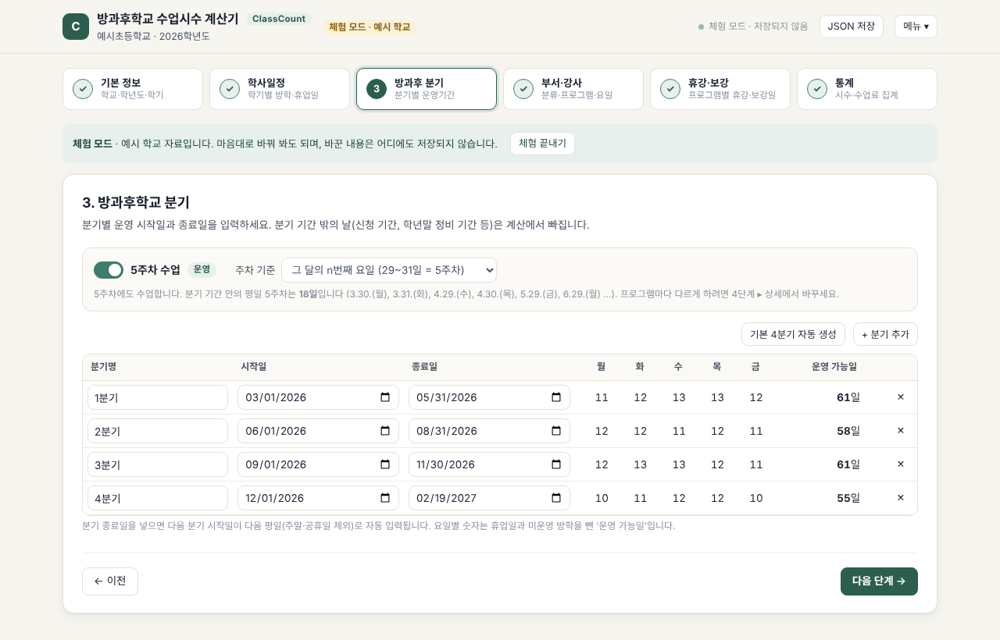
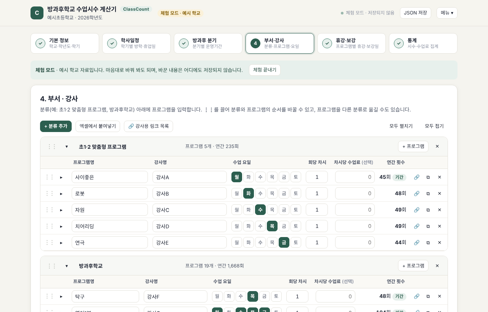
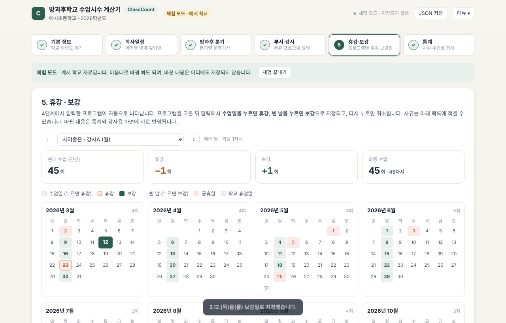
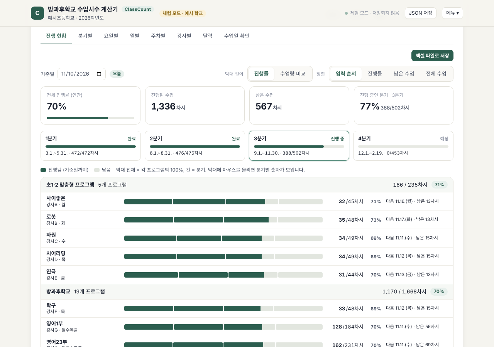
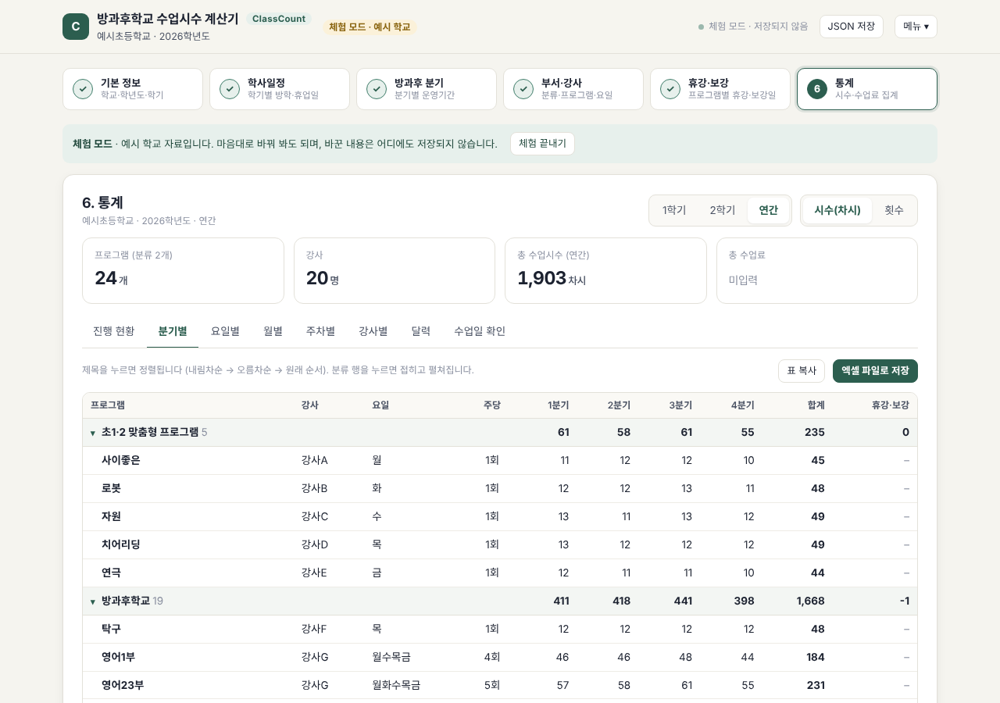
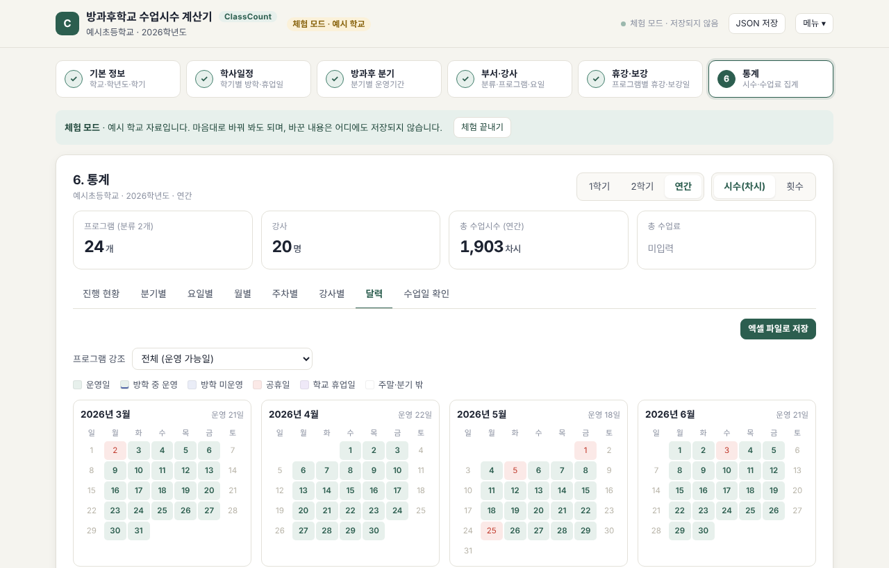
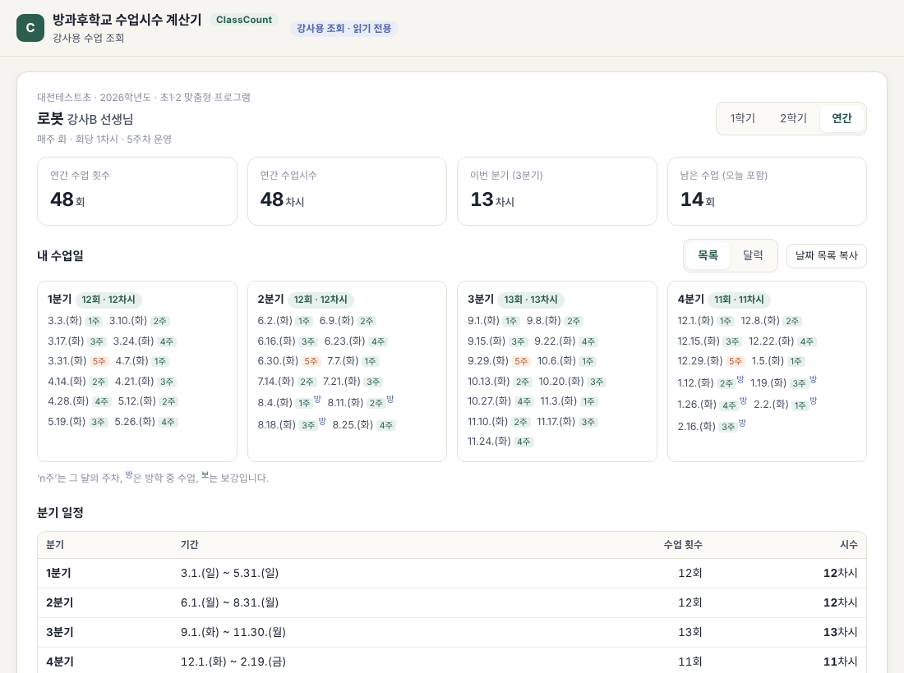

# ClassCount 사용 설명서 (방과후 담당 교사용)

## 시작하기

첫 화면에서 다음 중 하나를 고릅니다.

| 메뉴 | 언제 |
|---|---|
| **학교 로그인** | 학교가 이미 등록되어 있을 때. 학교코드 또는 학교명 + 비밀번호 |
| **새 학교 만들기** | 처음 쓸 때. 학교명·학교코드(예: NEIS 학교코드)·비밀번호 |
| **등록된 학교 찾기** | 우리 학교가 이미 있는지 확인할 때 |
| **예시 학교로 체험하기** | 가입 없이 기능을 살펴볼 때(저장되지 않음) |
| **서버 없이 이 기기에서만 사용** | 서버가 없는 배포(GitHub Pages 등)이거나 혼자 쓸 때 |
| **강사용 조회** | 강사가 6자리 코드로 자기 수업을 볼 때 |

입력 내용은 자동으로 저장됩니다(학교 계정: 서버, 기기 전용: 이 브라우저). 화면 맨 아래에 현재 버전과 ‘변경 내역’이 있습니다.

---

## 1단계 · 기본 정보
- 학교명, **학년도**(2000~2100년), 학기(통계 기본 범위), 담당자를 입력합니다.
- 학년도를 넣으면 학사일정 기간이 **해당 연도 3월 1일 ~ 다음 해 2월 마지막 날**로 자동 설정됩니다.
- 학년말에는 여기서 **‘다음 학년도로 전환’** 을 누릅니다(아래 ‘학년도 전환’ 참고).

## 2단계 · 학사일정

- **1학기 종료일(여름방학식)** 과 **2학기 시작일(개학일)** 을 넣으면 여름방학이 ‘종료일 다음 날 ~ 개학 전날’로 자동 입력됩니다. 방학 날짜를 직접 고치면 그 뒤로는 덮어쓰지 않습니다.
- **공휴일 자동 추가** 로 법정 공휴일·대체공휴일을 넣습니다(2026~2028년, 주말과 겹친 날은 생략).
- 재량휴업일·개교기념일·방과후 정비 기간 등은 ‘+ 추가’ 또는 ‘여러 줄 붙여넣기’로 넣습니다. 기간이면 종료일까지 입력합니다.
- 방학 중에도 방과후를 운영하면 방학의 **‘방과후 운영’** 을 켭니다.
- 색 구분: **공휴일 = 빨강**, **학교가 정한 휴업일 = 보라**.
- 날짜는 칸을 벗어나거나 Enter를 누를 때 확정됩니다.
- 최고관리자가 임시공휴일·선거일을 추가하면 2단계 위쪽에 **‘학사일정에 없는 평일 공휴일’** 안내가 뜹니다. ‘추가’를 누르면 휴업일로 들어가고, 그날도 방과후를 운영한다면 ‘무시’를 누르세요.

## 3단계 · 방과후 분기

- **기본 4분기 자동 생성**(3~5월, 6~8월, 9~11월, 12~2월)을 누르거나 직접 입력합니다.
- 분기 **종료일을 넣으면 다음 분기 시작일이 다음 평일**(주말·공휴일 제외)로 자동 입력됩니다.
- **5주차 수업**: 끄면 5주차 수업이 모든 프로그램에서 빠집니다. 기준은 ‘그 달의 n번째 요일(29~31일 = 5주차)’ 또는 ‘달력 주(월요일 시작)’ 중 고릅니다.
- 표의 요일별 숫자는 휴업일·미운영 방학을 뺀 운영 가능일입니다.

## 4단계 · 부서·강사

- **분류**(예: 초1·2 맞춤형 프로그램, 방과후학교) 아래에 **프로그램**을 넣습니다.
- ⋮⋮ 를 끌어 분류·프로그램 순서를 바꾸거나 다른 분류로 옮깁니다. ▾/▸ 로 접고 펼칩니다.
- 프로그램마다 강사명, 수업 요일, 회당 차시, 차시당 수업료(선택)를 넣습니다.
- ▸(상세)에서 운영 시작·종료일, 방학 중 운영, 5주차 운영 여부, 메모를 정합니다.
- **엑셀에서 붙여넣기**: `프로그램명 · 강사명 · 요일 · 회당 차시 · 수업료` 순서의 열을 복사해 붙여넣습니다.
- 🔗 : 강사용 링크(아래 참고)
- **목록 보기 / 모두 편집**: ‘목록 보기’는 프로그램을 한 줄씩(이름·강사·요일·차시·수업료·횟수) 보여 주고, 줄을 누르면 그 프로그램만 고칠 수 있게 열립니다(‘완료’로 닫기). 휴대폰에서는 처음부터 목록 보기로 열립니다. ‘모두 편집’은 모든 칸을 한꺼번에 펼칩니다.
- **찾기**: 프로그램명·강사명·요일로 바로 걸러 볼 수 있습니다.
- **순서 · 분류 옮기기**: ⋮⋮를 끌어도 되고, 휴대폰처럼 끌기 어려울 때는 ▸ 상세에서 ↑ ↓ 버튼과 ‘분류 옮기기’를 쓰세요.
- 위쪽 요약 줄에 프로그램·강사 수와 ‘요일 미선택’, ‘이름 없음’ 같은 빠진 입력이 표시됩니다.

## 5단계 · 휴강·보강

- 4단계 프로그램이 자동으로 나타납니다. 위쪽에서 프로그램을 고릅니다(‹ › 로 이동).
- 달력에서 **수업일을 누르면 휴강**, **빈 날을 누르면 보강**, 다시 누르면 취소됩니다.
- 아래 목록에 사유를 적거나, 날짜로 직접 추가합니다.
- 원래 수업 → 휴강 → 보강 → 최종 횟수와 전체 프로그램 현황이 함께 보입니다.

## 6단계 · 통계

- 첫 화면은 **진행 현황**입니다. 기준일(기본: 오늘)까지 진행된 수업을 프로그램별 **가로 막대**로 보여 줍니다.
  - 위쪽: 전체 진행률, 진행된 수업, 남은 수업, 진행 중인 분기
  - 분기 칸: 분기마다 완료·진행 중·예정 상태와 진행 막대
  - 프로그램 막대: 칸 하나가 분기, 진한 부분이 진행된 수업. 마우스를 올리면 분기별 숫자가 보입니다. 오른쪽에 다음 수업일과 남은 시수
  - **막대 길이**: ‘진행률’(프로그램마다 100%) 또는 ‘수업량 비교’(가장 많은 프로그램 기준), **정렬**: 입력 순서·진행률·남은 수업·전체 수업
  - 기준일을 바꾸면 그날까지의 진행 상황을 볼 수 있습니다(예: 분기 말 정산)
- 위쪽에서 **1학기/2학기/연간**, **시수(차시)/횟수** 를 고릅니다.
- 탭: 진행 현황 · 분기별 · 요일별 · 월별 · 주차별 · 강사별 · 달력 · 수업일 확인

- 표의 **제목을 누르면 내림차순 → 오름차순 → 원래 순서**로 정렬, **분류 행을 누르면** 접기/펼치기.
- **엑셀 파일로 저장**: 분기별(분류 소계)·강사별·요일별·월별·수업일지·주차별·휴강·보강·학사일정 시트
- **표 복사**: 엑셀에 바로 붙여넣기
- **🖨 화면 출력**: 지금 보고 있는 통계 화면(진행 현황·분기별·달력 등) 그대로 **미리보기 창**을 띄웁니다. A4 세로/가로를 고르면 쪽수와 축소 비율이 표시되고, **인쇄**·**PDF 저장**·**JPG 저장** 중에서 고릅니다. 넓은 표는 종이 폭에 맞게 자동으로 줄이고, PDF는 표의 줄 사이에서 쪽을 나눕니다.
- **수업 확인서 인쇄**: 분기(또는 연간)와 프로그램을 고르면 강사별 수업일·주차·차시·보강·휴강·합계(선택: 수업료)를 A4 한 장으로 인쇄합니다. 수업이 많으면 두 단으로 줄여 한 장에 맞춥니다. **단순 확인용 참고 자료이며 법적 효력은 없습니다**(서명란 없음).

---

## 강사용 링크

- 4단계의 🔗 또는 **‘강사용 링크 목록’**(전체 복사)에서 링크를 받습니다.
- 강사는 로그인 없이 **자기 프로그램의 수업일(목록/달력)·시수·다음 수업일·이번 달 수업(지난 수업·휴강·보강 표시)·분기 일정·학사일정**만 봅니다. 수업료와 메모는 보이지 않습니다.
- 강사도 화면의 ‘수업 확인서 인쇄’로 자기 수업 확인서를 뽑을 수 있습니다(수업료 제외).
- 링크 대신 6자리 코드를 첫 화면 ‘강사용 조회’에 넣어도 됩니다.
- 링크가 퍼졌다면 **‘새 링크 만들기’** — 이전 링크는 바로 막힙니다.

## 학년도 전환
1. 1단계의 **‘○○학년도로 전환’** 을 누릅니다.
2. 옵션을 확인합니다: 강사용 링크 유지, 분기 날짜 1년 뒤로, 새 학년도 공휴일 자동 추가, 공휴일 외 휴업일도 1년 뒤로 복사.
3. 전환되면 **분류·프로그램·강사·요일·차시·수업료**가 그대로 복사되고, 학사일정(방학 날짜·2학기 시작일 등)과 휴강·보강은 비워집니다. 2단계에서 학사일정을 채우세요.
4. 지난 학년도는 상단의 **학년도 선택**에서 ‘조회 전용’으로 볼 수 있습니다(통계·엑셀 저장 가능, 수정 불가).

## 저장과 백업
- **자동 저장**: 입력하면 바로 이 기기에 저장되고, 서버에는 **30초 동안 모아서** 한 번에 저장합니다(Cloudflare 무료 한도 절약). 오른쪽 위 저장 표시를 누르면 바로 저장되고, 화면을 닫거나 다른 창으로 옮길 때도 저장합니다.
- **다른 기기에서 동시에 고친 경우**: 교무실 PC와 노트북처럼 두 곳에서 같은 학교를 고치면, 나중에 저장하는 쪽에 경고가 뜨고 자동 저장이 멈춥니다. ‘서버 내용 불러오기’(추천), ‘내 내용을 JSON 파일로 먼저 저장’, ‘내 내용으로 덮어쓰기’ 중에서 고르세요. 덮어쓰기 전 서버 내용은 백업에 남습니다.
- **자동 백업·복원**(메뉴 → 백업 · 복원): 날마다 처음 고치기 전 상태가 자동으로 백업됩니다. 서버에 최근 10개, 이 기기에 최근 7일치가 남습니다. 실수로 지우거나 잘못 고쳤을 때 ‘복원’을 누르면 되돌아가고, 복원 직전 내용도 다시 백업되므로 또 되돌릴 수 있습니다.
- **JSON 저장**(상단 버튼): 현재 학년도 자료를 파일로 내려받습니다. ‘JSON 파일 불러오기’로 되살립니다. 오래 보관할 자료는 JSON으로 저장해 두세요.
- 기기 전용 모드에서는 JSON으로 저장하지 않은 변경이 있으면 상단에 표시되고, 페이지를 떠날 때 경고합니다.
- **학교명 변경**: 1단계에서 학교명을 고치면 저장할 때 ‘학교 찾기’와 학교명 로그인에도 함께 반영됩니다(학교코드는 그대로). 같은 이름의 학교가 이미 있으면 안내가 뜨고, 이때는 학교코드로 로그인합니다.
- 비밀번호를 잊으면 최고관리자에게 초기화를 요청하세요. 임시 비밀번호로 로그인하면 새 비밀번호를 정하게 됩니다.

## 자주 묻는 질문
| 질문 | 답 |
|---|---|
| 같은 이름의 학교가 있어요 | 학교코드로 로그인하세요. ‘등록된 학교 찾기’에서 코드를 확인할 수 있습니다 |
| ‘새 학교 만들기’가 흐려요 | 최고관리자가 생성을 꺼 두었습니다. 최고관리자에게 문의하세요 |
| 격주 수업은요? | 휴강·보강 메뉴에서 쉬는 주를 휴강으로 지정하세요(규칙형 격주 입력은 개선 예정) |
| 2029년 공휴일이 없어요 | 내장 공휴일은 2028년까지입니다. 2단계에서 직접 추가하세요 |
